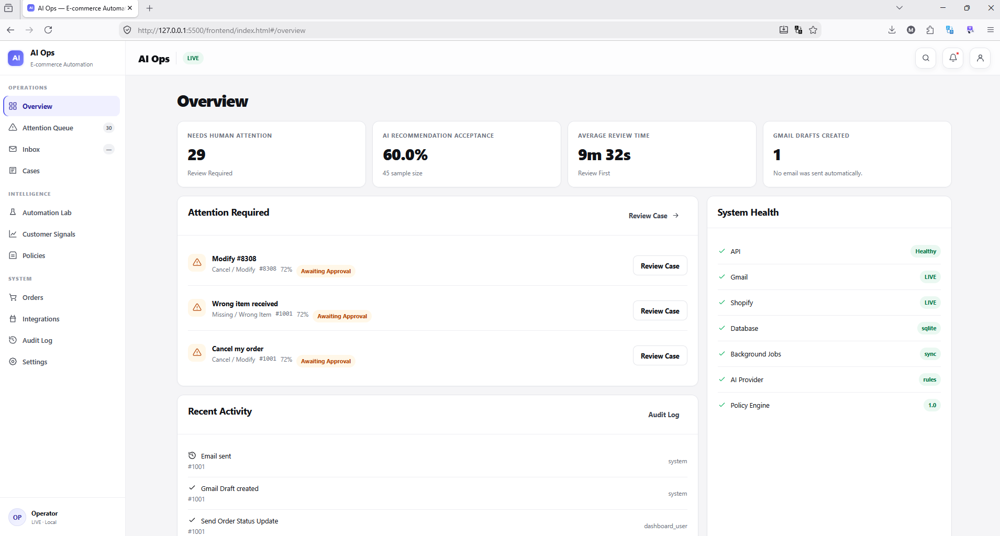
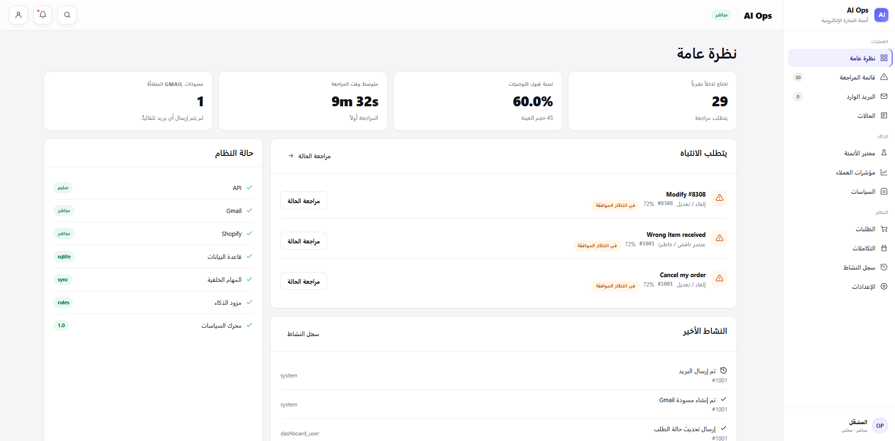
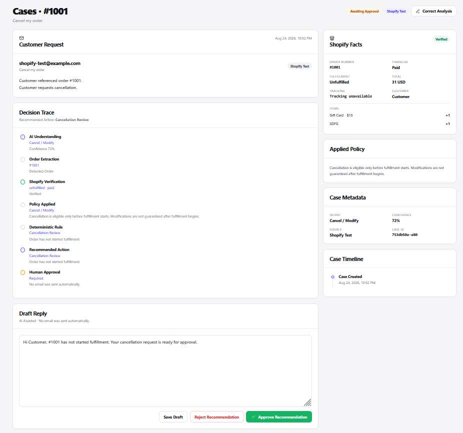
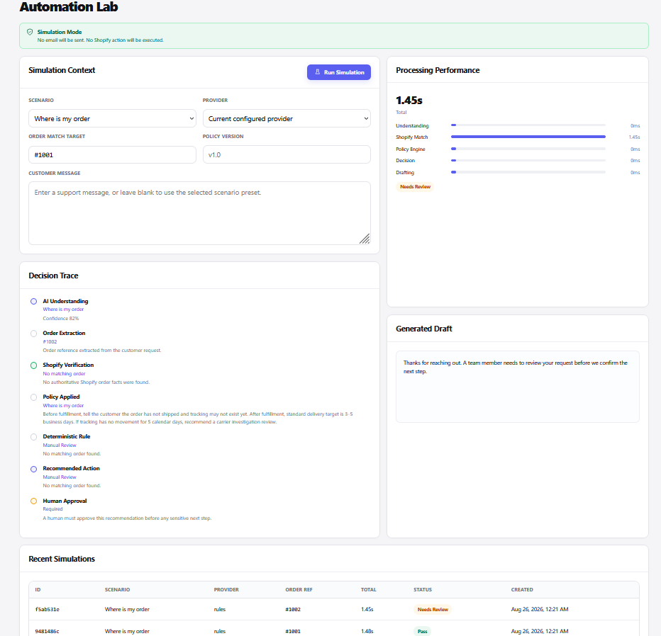

# AI Ops — E-commerce Operations Automation

A review-first AI operations system for Shopify customer support.

It connects Gmail support requests to verified Shopify order data, applies store policies and deterministic business rules, generates explainable recommendations, and keeps a human operator in control before any customer-facing action.

---
## Product Preview

### Overview — English


### Overview — Arabic RTL


### Case Workspace


### Automation Lab


## What It Does

The system currently handles four support workflows:

- Where is my order?
- Return / Refund
- Missing / Wrong Item
- Cancel / Modify Order

Core workflow:

```text
Customer Email
      ↓
Gmail ingestion + cleanup
      ↓
AI / Rules understanding
      ↓
Order extraction
      ↓
Shopify verified facts
      ↓
Policy constraints
      ↓
Deterministic decision engine
      ↓
Decision Trace
      ↓
Human review / correction
      ↓
Approved Gmail reply draft
```

The AI does not directly execute sensitive business actions.

---

## Key Features

- Gmail support inbox integration
- Shopify Admin API read-only order lookup
- Explainable Decision Trace
- Human-in-the-loop approval workflow
- Editable AI-assisted reply drafts
- Human corrections with audit history
- Automation Lab / safe simulation mode
- Processing performance timings
- Customer support signals
- Policies management
- Audit log
- English and Arabic RTL support
- Demo and Live environments
- Dockerized multi-service architecture
- PostgreSQL persistence
- Redis + Celery background processing
- GitHub Actions CI
- CodeQL security analysis
- Dependabot dependency monitoring

---

## Safety Architecture

The system follows a strict boundary:

```text
LLM understands the request
Shopify provides authoritative facts
Policy provides constraints
Deterministic rules decide business actions
Human approves sensitive actions
```

By default:

- Gmail auto-send is disabled
- Shopify refund/cancel/modify mutations are disabled
- Customer email content is treated as untrusted input
- Order information is protected by sender/order identity checks
- Manual Gmail send is optional and disabled by default

---

## Tech Stack

### Backend

- Python
- FastAPI
- SQLAlchemy
- PostgreSQL
- Redis
- Celery

### Frontend

- Vanilla HTML
- CSS
- JavaScript
- Responsive RTL/LTR interface
- Nginx

### Integrations

- Gmail API
- Shopify Admin GraphQL API
- Optional OpenAI API

### Infrastructure

- Docker
- Docker Compose
- GitHub Actions
- CodeQL
- Dependabot

---

## Architecture

```text
                    ┌─────────────────┐
                    │     Browser     │
                    └────────┬────────┘
                             │
                    ┌────────▼────────┐
                    │ Frontend/Nginx  │
                    └────────┬────────┘
                             │
                    ┌────────▼────────┐
                    │     FastAPI     │
                    └───┬─────────┬───┘
                        │         │
               ┌────────▼───┐ ┌──▼───────┐
               │ PostgreSQL │ │  Redis   │
               └────────────┘ └──┬───────┘
                                  │
                           ┌──────▼──────┐
                           │Celery Worker│
                           └─────────────┘

External integrations:
FastAPI → Gmail API
FastAPI → Shopify Admin API
FastAPI → OpenAI API (optional)
```

---

## Run With Docker

The easiest way to run the demo stack:

```bash
docker compose up --build
```

Then open:

```text
http://localhost:3000
```

Backend health endpoint:

```text
http://localhost:8000/api/v1/health
```

Docker Compose runs:

```text
Frontend / Nginx
FastAPI
PostgreSQL
Redis
Celery Worker
```

---

## Demo Mode

The public project can run without real Gmail, Shopify, or OpenAI credentials.

Example configuration:

```env
AI_PROVIDER=rules

SHOPIFY_MODE=mock
GMAIL_MODE=mock

TASKS_MODE=celery

AUTH_MODE=off
ALLOW_LIVE_ACTIONS=false
GMAIL_MANUAL_SEND_ENABLED=false
```

This keeps the public demo isolated from real customer data.

---

## Live Integrations

Private/local environments can connect to:

### Gmail

- Read support inbox
- Process customer emails
- Create reply drafts
- Optional reviewed manual send

### Shopify

- Read orders
- Read customer/order facts
- Verify fulfillment and tracking state

Shopify mutations remain disabled.

---

## AI Provider

The project works completely with the deterministic Rules provider.

OpenAI can optionally be enabled:

```env
AI_PROVIDER=openai
AI_FALLBACK_TO_RULES=true
OPENAI_API_KEY=...
OPENAI_MODEL=...
```

The LLM is used for language understanding and drafting, not as the authority for business actions.

---

## Testing

Run backend verification:

```bash
cd backend
python scripts/verify.py
```

The test suite covers:

- API behavior
- authentication
- decision rules
- Gmail message cleanup
- repository behavior
- security guards
- workflow features
- deterministic regression cases

---

## Security

The repository intentionally excludes:

```text
.env
credentials.json
token.json
local databases
virtual environments
customer data
API secrets
```

Security tooling includes:

- CodeQL
- Dependabot
- release safety checks
- production error sanitization
- sender/order identity verification
- prompt-injection boundaries

See [SECURITY.md](SECURITY.md) and [docs/SECURITY.md](docs/SECURITY.md).

---

## Project Scope

This project intentionally does not include:

- automatic AI email sending
- autonomous Shopify refunds
- autonomous cancellations
- autonomous replacements
- marketing automation
- CRM functionality
- WhatsApp / voice support
- multi-tenant SaaS billing

These are product decisions rather than unfinished functionality.

---

## Why I Built It

The project explores how AI can be used safely in operational workflows where language understanding is useful but business decisions still need verified data, deterministic constraints, traceability, and human oversight.

It was built as a practical AI Engineering project covering:

- LLM application architecture
- external API integration
- deterministic decision systems
- human-in-the-loop workflows
- asynchronous processing
- Docker
- security boundaries
- production-oriented backend design

---

## Repository Structure

```text
backend/
  app/
  tests/
  scripts/

frontend/
  css/
  js/
  assets/

docs/

.github/
  workflows/
  dependabot.yml

docker-compose.yml
docker-compose.live.yml
README.md
SECURITY.md
```

---

## License / Source Notice

This repository is public for portfolio review and technical evaluation.

It is not released under an open-source license.

See [NOTICE.md](NOTICE.md).
